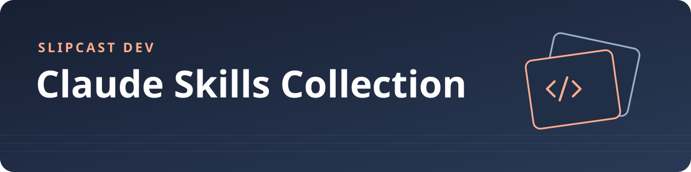

# Коллекция навыков для Claude



[English](README.md) · **Русский**

[](https://github.com/Slipcast-dev/claude-skills/stargazers)
[](https://github.com/Slipcast-dev/claude-skills/releases/latest)
[](https://github.com/Slipcast-dev/claude-skills/releases)
[](https://github.com/Slipcast-dev/claude-skills/actions/workflows/validate.yml)
[-blue.svg)](LICENSE)

Коллекция [Agent Skills](https://code.claude.com/docs/en/skills) для Claude Code и других инструментов, которые читают файлы `SKILL.md`. В репозитории есть каталог по темам и сценарии установки, проверки и обновления каталога.

> [!IMPORTANT]
> Для навыков сторонних авторов действуют их собственные лицензии. Перед повторным использованием и распространением проверьте [сведения о сторонних материалах](THIRD_PARTY_NOTICES.md).

Счётчик учитывает скачивания прикреплённых к релизам файлов. Клонирования и автоматические архивы исходников в эту метрику не входят.

## Каталог

Ссылки ведут к спискам навыков с оригинальными названиями и описаниями.

<!-- INDEX:START -->
| Категория | Навыки |
|---|---:|
| [ИИ и агенты](skills/ai-agents/) | 174 |
| [Разработка ПО](skills/software-engineering/) | 175 |
| [Безопасность и соответствие требованиям](skills/security-compliance/) | 61 |
| [Данные и аналитика](skills/data-analytics/) | 80 |
| [Продукт и дизайн](skills/product-design/) | 68 |
| [Маркетинг, продажи и рост](skills/marketing-sales/) | 181 |
| [Бизнес, стратегия и финансы](skills/business-strategy/) | 188 |
| [Команды, HR и лидерство](skills/people-leadership/) | 137 |
| [Тексты и коммуникация](skills/writing-communication/) | 255 |
| [Образование и исследования](skills/education-research/) | 75 |
| [Продуктивность и рабочие процессы](skills/productivity/) | 115 |
| [Мышление и принятие решений](skills/thinking-decisions/) | 26 |
| [Право и государственные услуги](skills/legal-government/) | 53 |
| [Личные финансы](skills/personal-finance/) | 63 |
| [Здоровье и благополучие](skills/health-wellness/) | 27 |
| [Дом, семья и образ жизни](skills/personal-life/) | 138 |
| **Итого** | **1816** |
<!-- INDEX:END -->

## Установка

Клонируйте репозиторий или скачайте и распакуйте исходники из [последнего релиза](https://github.com/Slipcast-dev/claude-skills/releases/latest). Выполняйте команды установки из корня репозитория.

```bash
git clone https://github.com/Slipcast-dev/claude-skills.git
cd claude-skills

# Установить все навыки, пропуская уже установленные с тем же именем
scripts/install.sh

# Установить только выбранные категории
scripts/install.sh software-engineering ai-agents

# Создать символические ссылки, чтобы изменения после git pull применялись сразу
MODE=link scripts/install.sh

# Установить навыки только в указанный проект
DEST=/path/to/project/.claude/skills scripts/install.sh productivity
```

Для ручной установки скопируйте целую папку навыка вместе с её вспомогательными файлами.

```bash
mkdir -p ~/.claude/skills
cp -R skills/thinking-decisions/premortem-assassin ~/.claude/skills/
```

У 1 706 навыков в заголовке `SKILL.md` задано `disable-model-invocation: true`: они запускаются явно, например командой `/premortem-assassin`. У остальных 110 навыков этот параметр отсутствует, поэтому Claude может выбирать их автоматически. Перед установкой проверьте заголовок нужного навыка.

Для `driver-mas` нужны отдельно настроенные MAS CLI (`~/.claude/mas/bin/mas`) и определения агентов. Для `skill-finder` нужен отдельно поддерживаемый индекс `~/.claude/skill-index.tsv`. Эти зависимости не входят в коллекцию и не создаются сценарием установки.

## Структура и формат

- `skills/<категория>/<навык>/SKILL.md` содержит метаданные и инструкции навыка. При необходимости рядом находятся `references/`, `scripts/` и другие вспомогательные файлы.
- `categories.json` хранит названия и описания категорий.
- `scripts/` содержит установщик и инструменты проверки.
- `.github/` содержит проверки GitHub Actions и шаблоны обращений и pull request.

В YAML-заголовке `SKILL.md` укажите `name` и `description`. Имя должно совпадать с именем папки и быть уникальным во всей коллекции.

## Проверка и обновление

Для проверки и генерации каталога нужен Python 3.9 или новее. Дополнительные пакеты не требуются.

```bash
python3 scripts/validate_skills.py
python3 scripts/build_index.py
python3 scripts/build_index.py --check
bash -n scripts/install.sh
```

## Участие и лицензии

- Правила внесения изменений описаны в [CONTRIBUTING.md](CONTRIBUTING.md). Для общения в проекте действует [кодекс поведения](CODE_OF_CONDUCT.md).
- Об уязвимостях сообщайте приватно по инструкции в [SECURITY.md](SECURITY.md).
- Инструменты и документация распространяются под [MIT](LICENSE). Лицензии на отдельные навыки описаны в [THIRD_PARTY_NOTICES.md](THIRD_PARTY_NOTICES.md) и в самих навыках.
